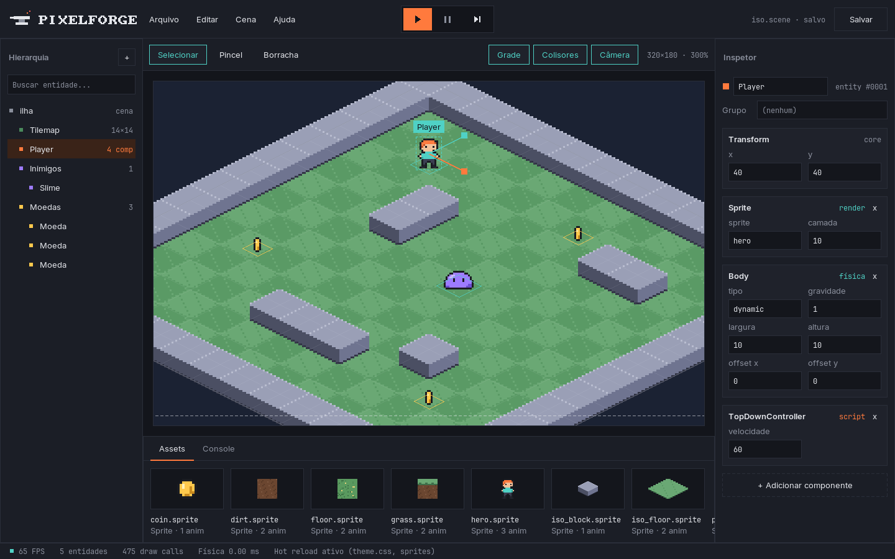
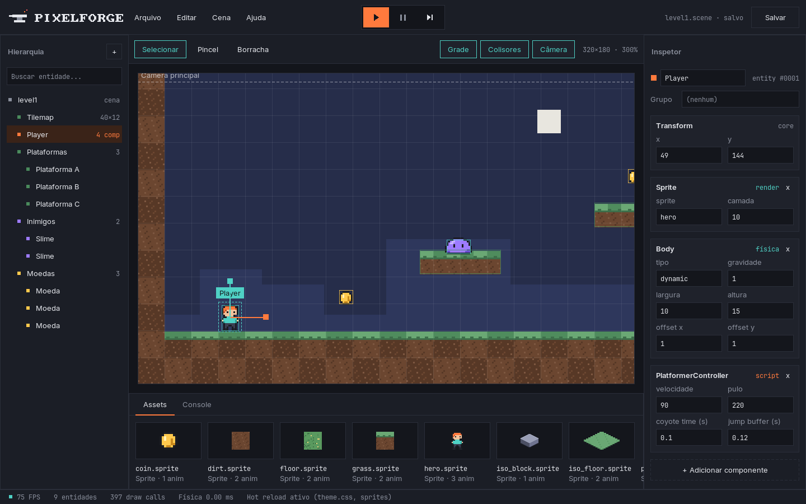
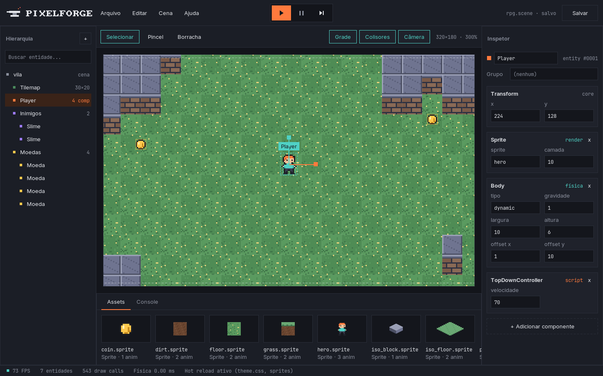
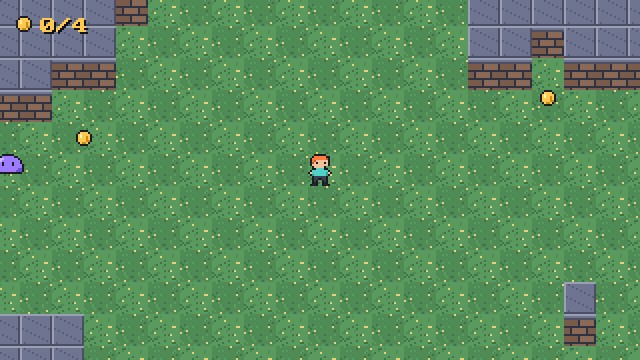

# PixelForge

Engine 2D em **C++20 + SDL3** com editor embutido, feita para pixel art. Uma mesma cena pode usar câmera de
**plataforma**, **RPG visto de cima** ou **isométrica**.



| Plataforma | RPG (de cima) |
| --- | --- |
|  |  |

## Recursos

- **Três câmeras** por cena: lateral com gravidade e pulo, de cima com 8 direções e isométrica com blocos e ordenação por profundidade.
- **Editor** com hierarquia (grupos e busca), inspetor de componentes editável, viewport com gizmo, zoom e pan,
  pincel e borracha de tiles, overlays de grade, colisores e câmera, play/pausa/avanço de quadro sobre uma cópia da cena.
- **Tema em CSS**: `assets/theme.css` define cores, medidas e tamanhos de fonte do editor, com recarga ao vivo.
- **Hot reload** do tema e dos sprites enquanto o editor está aberto.
- **Formatos em texto**, fáceis de versionar e editar à mão: cenas (`.scene`) e sprites em pixel art (`.sprite`).
- **Gameplay de plataforma** com coyote time, jump buffer e pulo variável; inimigos que patrulham; moedas com HUD.
- **Modo jogo** sem editor (`--play`) e captura de tela por linha de comando (`--screenshot`).

## Build

Requisitos: CMake 3.24+, compilador C++20 (GCC 13, Clang 16 ou MSVC recente) e Git.

```bash
cmake -S . -B build -G Ninja
cmake --build build
./build/pixelforge
```

O SDL3 (`release-3.2.10`) e o SDL3_ttf (`release-3.2.2`, com FreeType embutido) são baixados e compilados pelo CMake
via FetchContent quando não estão instalados no sistema.

| Comando | O que faz |
| --- | --- |
| `./build/pixelforge` | Abre o editor com `assets/scenes/level1.scene` |
| `./build/pixelforge assets/scenes/rpg.scene` | Abre o editor com outra cena |
| `./build/pixelforge --play` | Roda só o jogo, sem editor |
| `./build/pixelforge --screenshot shot.bmp` | Renderiza o editor (ou o jogo, com `--play`), salva a imagem e sai |
| `ctest --test-dir build` | Roda os testes de física, gameplay, projeção e serialização |

## Controles

| Contexto | Teclas |
| --- | --- |
| Plataforma | `A`/`D` ou setas para mover · `Espaço`, `W` ou `↑` para pular |
| RPG e isométrico | `WASD` ou setas (no isométrico, "cima" segue a tela) |
| Editor | `F5` play/stop · `F6` pausa · `F7` avança um quadro · `Ctrl+S` salva · `Ctrl+D` duplica · `Del` exclui |
| Ferramentas | `V` selecionar · `B` pincel de tiles · `E` borracha · `G` grade · `Shift` arrasta em passos de 8 px |
| Viewport | Roda do mouse dá zoom · botão direito ou do meio move a câmera · alças do gizmo movem em um eixo |

Troque de cena em **Arquivo → Abrir**. Para mudar a câmera, clique no nome da cena na hierarquia e escolha o modo no inspetor.

## Modos de câmera

| Modo | `camera` | Física | Controle | Exemplo |
| --- | --- | --- | --- | --- |
| Plataforma | `side` | gravidade, pulo | `controller` | `level1.scene` |
| RPG | `topdown` | sem gravidade, 8 direções | `topdown` | `rpg.scene` |
| Isométrica | `isometric` | igual ao RPG | `topdown` | `iso.scene` |

Física e gameplay sempre rodam no plano 2D do mundo; o que muda entre os modos é a `Projection`
([src/game/Projection.hpp](src/game/Projection.hpp)). No isométrico, `tela = (x − y, (x + y) / 2)` e o renderizador
ordena blocos e sprites por `x + y`. No RPG, os sprites são ordenados pelo pé e as paredes mostram a face frontal.



## Formatos

### Cena (`.scene`)

Texto, um comando por linha:

```
scene level1
camera side
backdrop #262d4a #2e375c #e8e6df
tilemap 40 12
row ........................................
row ########################...#############

entity 1 Player
transform 32 144
sprite hero 10
body dynamic 1 1 10 15 1
controller 90 220 0.1 0.12
```

| Comando | Significado |
| --- | --- |
| `camera <side\|topdown\|isometric>` | Modo de câmera da cena |
| `backdrop <céu> <colinas> <lua>` | Cores do fundo (no RPG e no isométrico só o céu é usado) |
| `tilemap <colunas> <linhas>` + `row` | Grade de tiles 16×16: `#` sólido, `.` vazio. O visual de cada tile é escolhido pelo modo |
| `entity <id> <nome>` | Começa uma entidade; as linhas seguintes são componentes |
| `group <nome>` | Agrupa a entidade na hierarquia |
| `transform <x> <y>` | Posição no mundo |
| `sprite <asset> <camada>` | Sprite e camada de desenho |
| `body <dynamic\|static> <ox> <oy> <largura> <altura> <gravidade>` | Colisor. No isométrico é a pegada no chão |
| `controller <velocidade> <pulo> <coyote> <buffer>` | Controle de plataforma |
| `topdown <velocidade>` | Controle de RPG/isométrico |
| `patrol <velocidade>` | Anda e vira em paredes (e bordas, na plataforma) |
| `pickup <valor>` | Coletável |

### Sprite (`.sprite`)

Pixel art em texto: `size L A`, `color <char> #rrggbb` e blocos `anim <nome> <fps>` com `frame`s de `A` linhas de `L`
caracteres (`.` é transparente). O player usa as animações `idle`, `run` e `jump`. Os sprites incluídos são gerados por
[tools/generate_sprites.py](tools/generate_sprites.py).

### Tema (`theme.css`)

Variáveis CSS dentro de `:root { ... }`. Cores aceitam `#rrggbb` ou `#rrggbbaa`; medidas aceitam `px`.

```css
:root {
  --accent: #ff7a3d;
  --sidebar-width: 230px;
  --font-size: 13px;
}
```

## Arquitetura

```
src/core      Geometry, Color, Theme (parser CSS), FileWatcher, Log
src/platform  Input
src/render    Renderer, TextRenderer (TTF), BitmapFont (pixel), SpriteLibrary
src/scene     Components, Scene/Tilemap, SceneSerializer
src/game      Projection, Physics (AABB por eixo), Gameplay, GameInput, GameRenderer
src/editor    Ui (modo imediato), Editor, Hierarchy, Inspector, Viewport, BottomPanel
tests         GameplayTests (executável registrado no CTest)
```

O código é organizado em uma biblioteca estática (`pixelforge_engine`) usada pelo executável e pelos testes.

## Fontes e licenças de terceiros

- [Inter](https://github.com/rsms/inter) e [JetBrains Mono](https://github.com/JetBrains/JetBrainsMono), sob SIL Open Font
  License 1.1 (licenças em [assets/fonts](assets/fonts)).
- `assets/fonts/pixel8.font`: fonte VGA 8×8 de domínio público (Marcel Sondaar / IBM), a mesma usada pelo SDL.
- [SDL3](https://github.com/libsdl-org/SDL) e [SDL3_ttf](https://github.com/libsdl-org/SDL_ttf), sob licença zlib.
